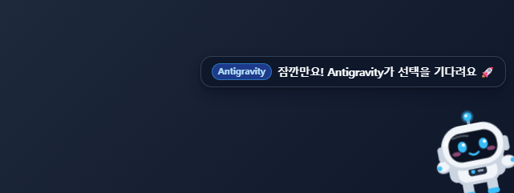
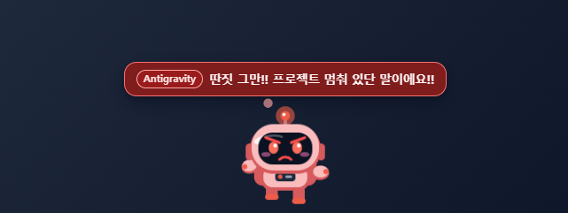
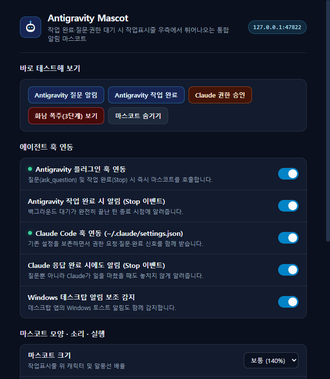

# Antigravity Mascot 🚀

**Antigravity**와 **Claude (Claude Code / Claude Desktop)**가 작업을 마쳤거나 사용자의 질문 응답·권한 승인을 기다릴 때, Windows 작업표시줄(상태표시줄) 우측 하단에서 무중력 우주인 캐릭터가 튀어나와 알려주는 통합 데스크탑 알림 앱입니다.

> 시켜놓고 다른 창을 보거나 딴짓하다가 확인 타이밍을 놓쳐 프로젝트 진행이 지연되는 문제를 해결하기 위해 제작되었습니다. ([OlegChe77/claude-mascot](https://github.com/OlegChe77/claude-mascot)에서 영감을 받아 Antigravity 네이티브 플러그인/훅 시스템과 통합 듀얼 에이전트 아키텍처로 새롭게 설계했습니다.)

| Antigravity 알림 (코스믹 시안) | Claude 알림 (코랄 앰버) |
| :---: | :---: |
|  |  |

| 3단계 화남 폭주 (작업표시줄 행진) | 설정 및 컨트롤 데크 |
| :---: | :---: |
|  |  |

---

## 주요 기능

1. **작업표시줄 위 3단계 감정 에스컬레이션**
   - **1단계 (살짝 빼꼼 × 2회)**: 우측 하단 모서리에서 무중력 우주인이 빼꼼 고개를 내밀며 손을 흔들고 어떤 에이전트(`Antigravity` / `Claude`)가 왜 기다리는지 한국어/영어 말풍선과 귀여운 신스 효과음으로 알려줍니다.
   - **2단계 (삐짐 빼꼼 × 1회)**: 계속 반응이 없으면 눈썹을 찌푸린 노란 우주복 상태로 나타나 투덜거립니다.
   - **3단계 (화남 폭주 · 20초)**: 빨갛게 달아올라 증기를 뿜으며 작업표시줄 위를 쿵쾅쿵쾅 왕복 행진합니다. 응답할 때까지 주기를 반복합니다.
2. **듀얼 에이전트 구분 및 원클릭 창 전환**
   - **Antigravity 호출 시**: 코스믹 시안/인디고 비콘 점등 + `[Antigravity]` 배지 표시 → 마스코트 클릭 시 즉시 **Antigravity 창**을 최상단으로 활성화합니다.
   - **Claude 호출 시**: 코랄/앰버 비콘 점등 + `[Claude]` 배지 표시 → 마스코트 클릭 시 즉시 **Claude 창**을 활성화합니다.
   - 사용자가 직접 해당 창으로 전환하거나 프롬프트를 입력하면 마스코트가 즉시 혼자 퇴장합니다.
3. **작업 방해 제로 (Focus-Safe & Click-Through)**
   - 투명 오버레이 창은 포커스를 빼앗지 않으며(`focusable: false`), 마스코트 캐릭터 본체를 제외한 모든 영역의 마우스 클릭이 뒤쪽 창으로 그대로 통과합니다.
4. **자동 훅 설정 & 컨트롤 데크 UI**
   - 실행 시 `~/.gemini/config/plugins/antigravity-mascot/` 플러그인(`hooks.json`)과 `~/.claude/settings.json` 훅을 안전하게 자동 구성합니다(기존 `impeccable` 등 다른 훅은 100% 보존하며 자동 백업 생성).
   - 마스코트 앱이 꺼져 있을 때도 훅 명령이 밀리초 단위로 안전하게 폴백(`{"decision":"allow"}`)되어 에이전트 실행을 절대 막지 않습니다.
   - 트레이 우클릭 메뉴와 **설정 및 컨트롤 데크 창**(트레이 더블클릭)을 모두 지원합니다.

---

## 감지하는 이벤트

| 대상 | 이벤트 | 마스코트 동작 |
| :--- | :--- | :--- |
| **Antigravity** | `PreToolUse` (`ask_question`) | 객관식 질문·선택 대기 시 즉시 호출 |
| **Antigravity** | `Stop` (`fullyIdle: true` / `ERROR`) | 작업 완료, 텍스트 확인 대기, 또는 오류 정지 시 호출 |
| **Antigravity** | `PreInvocation` / `PostToolUse` | 사용자가 응답하거나 새 턴이 시작되면 자동 퇴장 |
| **Claude Code** | `PermissionRequest` / `PreToolUse` / `Notification` | 권한 승인 및 질문 대기 시 호출 |
| **Claude Code** | `Stop` / `UserPromptSubmit` | 응답 완료 시 호출 / 다음 입력 시 자동 퇴장 |
| **Windows 알림** | `wpndatabase.db` 토스트 감지 | 데스크탑 앱의 네이티브 알림 발생 시 보조 호출 |

---

## 개발 및 빌드 방법

```powershell
# 1. 의존성 설치
npm install

# 2. 아이콘 에셋 생성 (최초 1회)
npm run icons

# 3. 개발 모드 실행
npm start

# 4. 자동 통합 테스트 실행
npm test

# 5. 단일 실행 파일(Portable .exe) 빌드 -> dist/AntigravityMascot-1.0.0-portable.exe
npm run dist:portable

# 6. 설치형(NSIS) + 포터블 동시 빌드
npm run dist
```

---

## 라이선스

MIT License © 2026 maker-KK
